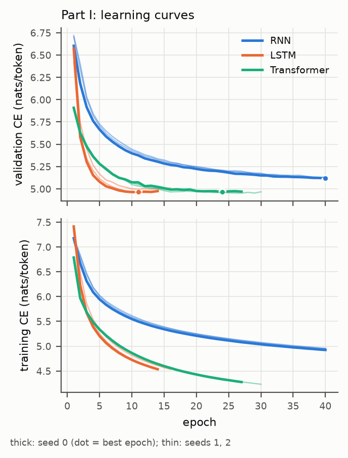
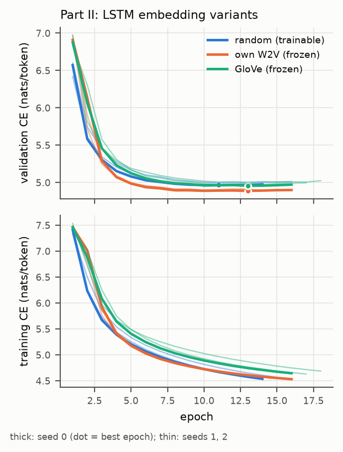
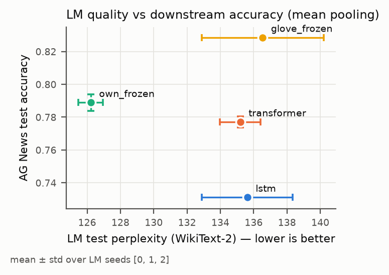
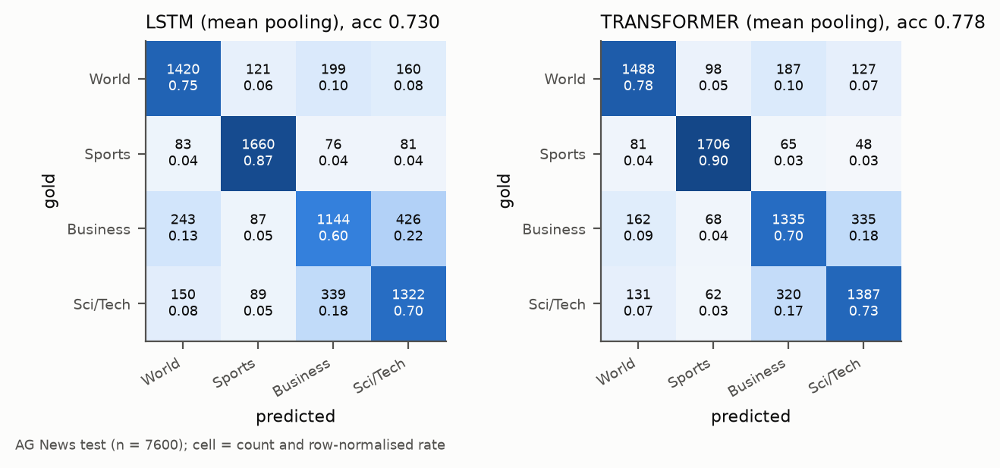

# DSA4213 Assignment 1 — report draft (auto-generated)

> Generated by `scripts/make_report.py` from `results/**/*.json`. Every interpretive sentence is tagged [OBSERVATION] or [HYPOTHESIS]; rewrite in your own words and delete the tags before submission.

## 0. Comparison question

*How do n-gram, RNN, LSTM and Transformer language models of matched size differ on WikiText-2, does fixing the input embeddings help the LSTM, and does better next-token prediction translate into better frozen features for topic classification?* (edit to taste)

## 1. Data and preprocessing

WikiText-2 (tokenized, `wikitext-2-v1`, official splits), lowercased, whitespace-split, empty lines dropped, `<eos>` appended to every line; the dataset's `<unk>` is our single `<unk>`. Vocabulary = all training types (V = 28913). Each split is one token stream cut into non-overlapping 128-token chunks (no state carried across chunks); the last chunk is padded and padded targets are excluded from the loss. All four models score exactly the same 244101 test targets.

| split | lines | tokens | <unk> rate |
|---|---|---|---|
| train | 23767 | 2075677 | 0.0263 |
| validation | 2461 | 216347 | 0.0542 |
| test | 2891 | 244102 | 0.0623 |

Vocabulary size V = 28913 (training split only, incl. <pad>, <unk>, <eos>).

## 2. Part I — model families

Setup: neural models share embedding dim 100, hidden/d_model 256, 2 layers, dropout 0.3, untied output layer, context 128, AdamW (wd 0.01), clip 1.0, batch 32, AMP; LR per architecture from a 2-epoch sweep on validation; early stopping (patience 3) on validation loss; test evaluated once on the best checkpoint. Trigram: interpolated with λ chosen by grid search on validation.

| model | test ppl | test CE (nats) | val ppl | emb params | core params | output params | total params | best epoch(s) | time to best (s) | train time (s) | s/epoch (train) | GPU tok/s | CPU tok/s | GPU latency 50 tok (ms) | CPU latency 50 tok (ms) |
|---|---|---|---|---|---|---|---|---|---|---|---|---|---|---|---|
| Trigram (interp.) | 248.73 | 5.5164 | 264.06 | – | – | – | 1.99M counts | – | 61 (count+λ search) | – | – | – | 334487 | – | 47.8 |
| RNN | 156.22 ± 1.04 | 5.0513 ± 0.0067 | 167.95 ± 1.01 | 2.89M | 0.22M | 7.43M | 10.55M | 40,39,39 | 1951 ± 19 | 1985 ± 10 | 47.6 ± 0.3 | 112182 | 9500 | 81.0 | 194.8 |
| LSTM | 135.62 ± 2.73 | 4.9097 ± 0.0200 | 144.52 ± 2.93 | 2.89M | 0.89M | 7.43M | 11.21M | 11,13,10 | 652 ± 81 | 822 ± 79 | 55.1 ± 1.2 | 94654 | 14929 | 166.2 | 235.5 |
| Transformer | 135.19 ± 1.23 | 4.9067 ± 0.0091 | 142.63 ± 1.05 | 2.89M | 1.64M | 7.43M | 11.96M | 24,27,16 | 1225 ± 311 | 1390 ± 311 | 52.9 ± 0.1 | 115679 | 12008 | 128.5 | 251.7 |

Mean ± std over seeds [0, 1, 2] for neural models ("(n=k)" marks rows with fewer finished seeds); n-gram is deterministic. Throughput: scoring every target of the test split, batch 32 chunks, median of 3 runs. Latency: greedy 50 new tokens, batch 1, median of 5 runs. Timing hardware in benchmark.json.

- [OBSERVATION] Test-perplexity ranking (best first): Transformer (135.2) < LSTM (135.6) < RNN (156.2) < trigram (248.7).
- [OBSERVATION] Best epochs per seed: Transformer [24, 27, 16]; LSTM [11, 13, 10]; RNN [40, 39, 39]. Stopping reasons: Transformer ['early_stopping', 'early_stopping', 'early_stopping']; LSTM ['early_stopping', 'early_stopping', 'early_stopping']; RNN ['max_epochs', 'max_epochs', 'max_epochs'].
- [OBSERVATION] LSTM (135.62 ± 2.73) and Transformer (135.19 ± 1.23) differ by 0.42 ppl, less than the seed-to-seed std: treat them as tied on test perplexity.
- [OBSERVATION] RNN: every seed hit the 40-epoch limit with its best epoch at or near the end ([40, 39, 39]), i.e. it was still improving; its result is limited by the training budget, not converged.
- [HYPOTHESIS] Differences between neural models may reflect inductive bias (recurrence vs attention), the small data size (2M tokens) favouring the more constrained model, the fixed 128-token context, or per-architecture LR/epoch budget; these runs do not separate these factors.
- [HYPOTHESIS] The output layer (256×V) dominates the parameter count of every neural model, so total parameters say little about the capacity of the sequence core.
- [OBSERVATION] Fill in: overfitting signs (train loss keeps falling while val loss rises after the best epoch) per model, from the loss-curve figure.

### Generated text

| part | model | decoding | distinct-1 | distinct-2 | repeated-trigram rate | <unk> rate |
|---|---|---|---|---|---|---|
| part1 | Trigram (interp.) | greedy | 0.032 | 0.041 | 0.892 | 0.248 |
| part1 | Trigram (interp.) | sample_t0.8_k40 | 0.316 | 0.706 | 0.004 | 0.136 |
| part1 | RNN | greedy | 0.084 | 0.159 | 0.579 | 0.100 |
| part1 | RNN | sample_t0.8_k40 | 0.364 | 0.739 | 0.025 | 0.088 |
| part1 | LSTM | greedy | 0.176 | 0.327 | 0.508 | 0.128 |
| part1 | LSTM | sample_t0.8_k40 | 0.388 | 0.727 | 0.062 | 0.112 |
| part1 | Transformer | greedy | 0.204 | 0.437 | 0.287 | 0.000 |
| part1 | Transformer | sample_t0.8_k40 | 0.456 | 0.833 | 0.021 | 0.044 |
| part2 | LSTM | greedy | 0.176 | 0.327 | 0.508 | 0.128 |
| part2 | LSTM | sample_t0.8_k40 | 0.388 | 0.727 | 0.062 | 0.112 |
| part2 | LSTM + own W2V (frozen) | greedy | 0.128 | 0.245 | 0.654 | 0.220 |
| part2 | LSTM + own W2V (frozen) | sample_t0.8_k40 | 0.384 | 0.722 | 0.054 | 0.080 |
| part2 | LSTM + GloVe (frozen) | greedy | 0.124 | 0.233 | 0.654 | 0.048 |
| part2 | LSTM + GloVe (frozen) | sample_t0.8_k40 | 0.352 | 0.747 | 0.042 | 0.128 |

50 new tokens for each of the 5 prompts, pooled; seed-0 checkpoints.

Example continuations (prompt 1, greedy and sampled), seed-0 models:

- **trigram / greedy**: *the history of the city began in the* → <unk> , and the <unk> , and the <unk> , and the <unk> , and the <unk> , and the <unk> , and the <unk> , and the <unk> , and the <unk> , and the <unk> , and the <unk> , and the <unk> , and the <unk> ,
- **trigram / sample_t0.8_k40**: *the history of the city began in the* → <unk> , the first . in september 30 , <unk> and <unk> ( <unk> " . the game , " a <unk> <unk> and a , the first ever <unk> towns and the of the <unk> are the the mike <unk> <unk> . the " in the <unk> of the
- **RNN / greedy**: *the history of the city began in the* → united states . <eos> = = = = = = = = = = = <eos> the first of the city was built in the united states . the <unk> was built in the united states . the <unk> was built in the united states . the <unk> was built
- **RNN / sample_t0.8_k40**: *the history of the city began in the* → early 20th century . <eos> = = = modern <unk> = = = <eos> at the time of the british isles , it has been a small gothic @-@ old church and the <unk> , a local <unk> in the <unk> <unk> . the <unk> also was the first of
- **LSTM / greedy**: *the history of the city began in the* → early 20th century . the <unk> of the <unk> of the <unk> , the <unk> of the <unk> , was the first of the <unk> , and the <unk> of the <unk> . the <unk> of the <unk> of the <unk> , the <unk> of the <unk> , was the
- **LSTM / sample_t0.8_k40**: *the history of the city began in the* → <unk> . the earliest neolithic in the minnesota river <unk> and <unk> ( asi ) in the south , were a <unk> @-@ owned name , although the missouri river has been now known as a local <unk> in the <unk> <unk> . the <unk> in the <unk> of the
- **Transformer / greedy**: *the history of the city began in the* → city . the city 's city was established in the city of galveston . <eos> = = = = = = <eos> galveston was a major city of galveston city in galveston . the galveston city was built in galveston . the galveston city 's galveston city was built in
- **Transformer / sample_t0.8_k40**: *the history of the city began in the* → 1960s . the film received positive reviews from critics <unk> and wrote that the film had been a major film , especially violent success , which included the film <unk> and the documentary of the film . the film had originally signed to the film in the film 's film

- [OBSERVATION] Fill in: concrete repetition / fluency / consistency differences (see `results/part1/generations.json` and the repeated-trigram rates above).

## 3. Part II — embedding ablation (LSTM)

Identical LSTM configuration, LR and seeds; only the input-embedding block differs. Own embeddings: gensim skip-gram (dim 100, window 5, min_count 1, negative 10, 10 epochs) on the training split only. Public: GloVe 6B 100d. Frozen tables: the entire table is fixed (`from_pretrained(freeze=True)`); missing words: `<pad>` = 0, `<unk>` = mean of covered vectors (if missing), others ~ N(0, σ²) with σ = std of covered vectors, fixed seed. Non-embedding initialisation is identical across variants for a given seed.

| embedding | test ppl | best val CE | var(best val CE) over seeds | best epoch(s) | val-loss spikes (>10%) | time to best (s) | trainable / frozen params | vocab type coverage | train-token coverage | embedding training time (s, CPU) |
|---|---|---|---|---|---|---|---|---|---|---|
| LSTM + random (trainable) | 135.62 ± 2.73 | 4.9733 ± 0.0202 | 2.71e-04 | 11,13,10 | 0,0,0 | 652 ± 81 | 11.21M / 0.00M | – | – | – |
| LSTM + own W2V (frozen) | 126.21 ± 0.73 | 4.8933 ± 0.0066 | 2.92e-05 | 13,11,10 | 0,0,0 | 627 ± 87 | 8.32M / 2.89M | 100.0% | 100.0% | 403 |
| LSTM + GloVe (frozen) | 136.54 ± 3.67 | 4.9777 ± 0.0242 | 3.91e-04 | 13,14,15 | 0,0,0 | 775 ± 62 | 8.32M / 2.89M | 96.2% | 94.7% | – |

Random-trainable row reuses the Part I LSTM runs. Coverage is over non-<pad> types and training tokens. Embedding training time (own Word2Vec) is separate from LM training.

- [OBSERVATION] Test-perplexity ranking: own_frozen (126.2) < random (135.6) < glove_frozen (136.5).
- [HYPOTHESIS] Frozen tables remove ~V×100 trainable parameters, which may reduce overfitting but also prevents adapting vectors to next-word prediction; GloVe additionally carries information from ~6B tokens of Wikipedia+Gigaword (and may overlap WikiText test text), so a GloVe advantage is not purely an architectural effect.
- [OBSERVATION] Fill in: convergence speed (best epoch) and stability (seed variance, spikes) differences.

## 4. Part III — downstream classification (AG News)

Frozen LMs (main comparison on the seed-0 checkpoints, repeated with the same protocol on the seed-1 and seed-2 checkpoints); each article (converted to WikiText conventions, truncated to 128 tokens) is encoded and the last-layer states are mean-pooled over non-pad positions (main comparison: LSTM vs Transformer). Classifier: StandardScaler + logistic regression, C chosen on validation accuracy, fitted on the 8k train set, test evaluated once.

| split | tokens (converted) | OOV before | OOV after |
|---|---|---|---|
| train | 346018 | 0.1870 | 0.0708 |
| val | 87569 | 0.1862 | 0.0704 |
| test | 328492 | 0.1862 | 0.0711 |

Before = lowercase + whitespace split; after = conversion to WikiText-2 conventions.

| representation | C (val) | val acc | test acc | test macro-F1 | LM test ppl (seed 0) |
|---|---|---|---|---|---|
| lstm_mean (main) | 0.1 | 0.7520 | 0.7297 | 0.7286 | 133.43 |
| transformer_mean (main) | 1.0 | 0.7930 | 0.7784 | 0.7782 | 135.51 |
| lstm_last | 1.0 | 0.6930 | 0.6916 | 0.6898 | 133.43 |
| transformer_last | 0.01 | 0.7140 | 0.7186 | 0.7180 | 135.51 |
| own_frozen_mean | 0.01 | 0.8105 | 0.7864 | 0.7857 | 125.43 |
| glove_frozen_mean | 0.01 | 0.8410 | 0.8272 | 0.8269 | 133.47 |
| glove_avg_baseline | 0.01 | 0.8855 | 0.8689 | 0.8688 | – |

AG News: 8,000 train / 2,000 val (stratified from official train, seed 0), 7,600 official test. StandardScaler + LogisticRegression; C chosen on validation accuracy.

| representation (mean pooling) | LM test ppl | ppl rank | test acc | downstream rank |
|---|---|---|---|---|
| lstm_mean | 133.43 | 2 | 0.7297 | 4 |
| transformer_mean | 135.51 | 4 | 0.7784 | 3 |
| own_frozen_mean | 125.43 | 1 | 0.7864 | 2 |
| glove_frozen_mean | 133.47 | 3 | 0.8272 | 1 |

### Part III over LM seeds

| representation | test acc (seed 0) | test acc mean ± std (seeds [0, 1, 2]) | per-seed acc | macro-F1 (seed 0) | macro-F1 mean ± std | LM test ppl mean ± std | C per seed |
|---|---|---|---|---|---|---|---|
| lstm_mean (main) | 0.7297 | 0.7312 ± 0.0020 | 0.7297 / 0.7334 / 0.7304 | 0.7286 | 0.7303 ± 0.0020 | 135.62 ± 2.73 | 0.1 / 0.01 / 0.01 |
| transformer_mean (main) | 0.7784 | 0.7771 ± 0.0035 | 0.7784 / 0.7732 / 0.7797 | 0.7782 | 0.7768 ± 0.0034 | 135.19 ± 1.23 | 1.0 / 10.0 / 0.1 |
| lstm_last | 0.6916 | 0.6948 ± 0.0057 | 0.6916 / 0.7014 / 0.6914 | 0.6898 | 0.6937 ± 0.0062 | 135.62 ± 2.73 | 1.0 / 0.01 / 0.01 |
| transformer_last | 0.7186 | 0.7190 ± 0.0099 | 0.7186 / 0.7093 / 0.7291 | 0.7180 | 0.7183 ± 0.0094 | 135.19 ± 1.23 | 0.01 / 0.1 / 0.01 |
| own_frozen_mean | 0.7864 | 0.7889 ± 0.0050 | 0.7864 / 0.7946 / 0.7857 | 0.7857 | 0.7883 ± 0.0049 | 126.21 ± 0.73 | 0.01 / 0.01 / 0.1 |
| glove_frozen_mean | 0.8272 | 0.8286 ± 0.0013 | 0.8272 / 0.8297 / 0.8288 | 0.8269 | 0.8284 ± 0.0014 | 136.54 ± 3.67 | 0.01 / 0.01 / 0.01 |
| glove_avg_baseline | 0.8689 | 0.8689 ± 0.0000 | 0.8689 / 0.8689 / 0.8689 | 0.8688 | 0.8688 ± 0.0000 | – | 0.01 / 0.01 / 0.01 |

Identical protocol for every LM seed (same AG News split, conversion, pooling, classifier, C grid on validation, test once). glove_avg_baseline does not depend on the LM seed. Std = sample std over LM seeds.

| LM seed | LSTM acc | Transformer acc | Transformer − LSTM | only LSTM right (b) | only Transformer right (c) | exact McNemar p |
|---|---|---|---|---|---|---|
| 0 | 0.7297 | 0.7784 | +0.0487 | 638 | 1008 | 6.6e-20 |
| 1 | 0.7334 | 0.7732 | +0.0397 | 664 | 966 | 7.6e-14 |
| 2 | 0.7304 | 0.7797 | +0.0493 | 591 | 966 | 1.7e-21 |
| mean ± std | 0.7312 ± 0.0020 | 0.7771 ± 0.0035 | 0.0459 ± 0.0054 |  |  |  |

Mean pooling, main comparison. b/c count test articles that exactly one model classifies correctly; the exact McNemar test is a two-sided binomial test of b vs c (paired, same test set, per LM seed).

| representation (mean pooling) | LM test ppl (mean ± std) | ppl rank | test acc (mean ± std) | downstream rank |
|---|---|---|---|---|
| lstm_mean | 135.62 ± 2.73 | 3 | 0.7312 ± 0.0020 | 4 |
| transformer_mean | 135.19 ± 1.23 | 2 | 0.7771 ± 0.0035 | 3 |
| own_frozen_mean | 126.21 ± 0.73 | 1 | 0.7889 ± 0.0050 | 2 |
| glove_frozen_mean | 136.54 ± 3.67 | 4 | 0.8286 ± 0.0013 | 1 |

- [OBSERVATION] LSTM mean-pooled features: test accuracy 0.7297; Transformer: 0.7784.
- [OBSERVATION] Test articles where only the LSTM is right: 638; only the Transformer: 1008; both wrong: 1046 (examples in `results/part3/errors.json`).
- [OBSERVATION] Over LM seeds [0, 1, 2]: LSTM 0.7312 ± 0.0020, Transformer 0.7771 ± 0.0035; Transformer − LSTM per seed: +0.0487, +0.0397, +0.0493; exact McNemar p ≤ 7.6e-14 for every seed. The gap is consistent across checkpoints, not a single-seed effect.
- [OBSERVATION] Rank agreement (seed means, table above): compare the ppl rank with the downstream rank; LSTM and Transformer perplexities are within one std of each other.
- [HYPOTHESIS] Whether the LM-perplexity ranking matches the downstream ranking (table above) may depend on the domain shift WikiText → news and on what mean pooling keeps from each model's states.

## 5. Cross-part discussion, limitations, lessons

- Limitations: single small corpus (2M tokens); one LR sweep of 2 epochs per architecture; laptop GPU timing (thermal throttling possible); GloVe trained on Wikipedia 2014 + Gigaword may overlap WikiText test text; Part III uses frozen features and a linear classifier only; generated text from seed-0 checkpoints only; LRs chosen by a 2-epoch sweep (favours fast early progress); models that hit the epoch limit are not converged.

## Reproducibility

See README.md (commands, configs, seeds, hardware, runtimes). Tool use: see AI_USE.md.

